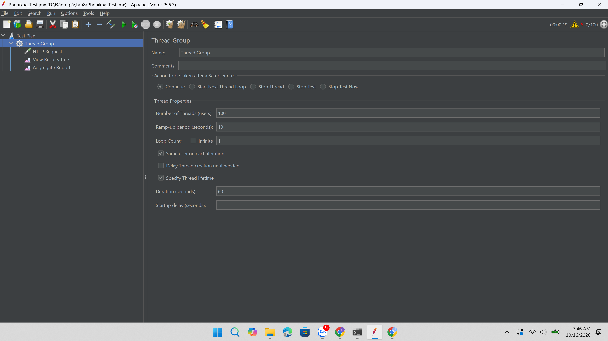
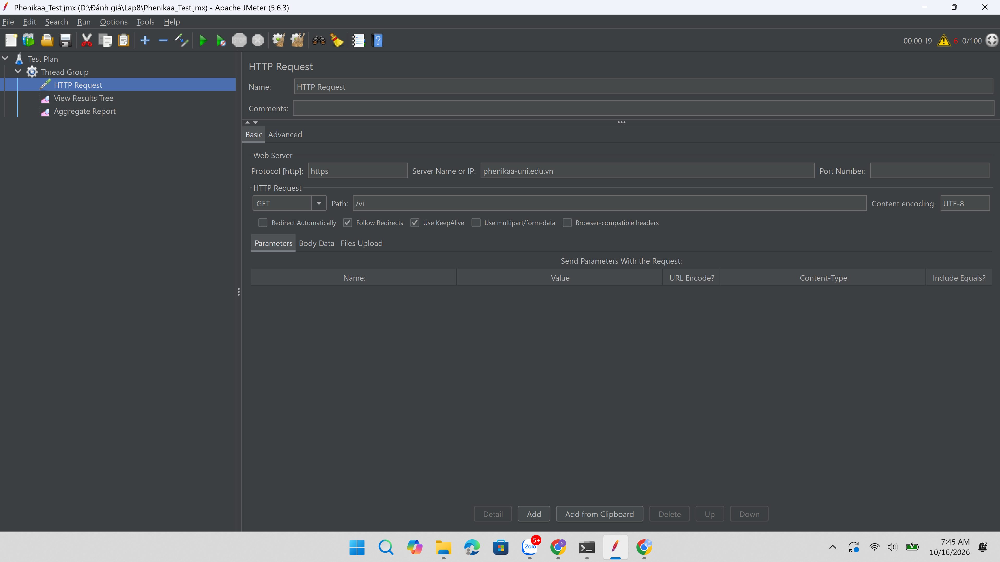
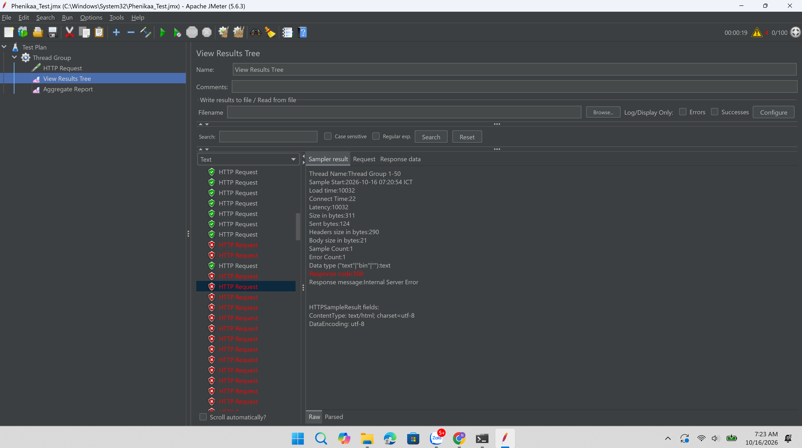
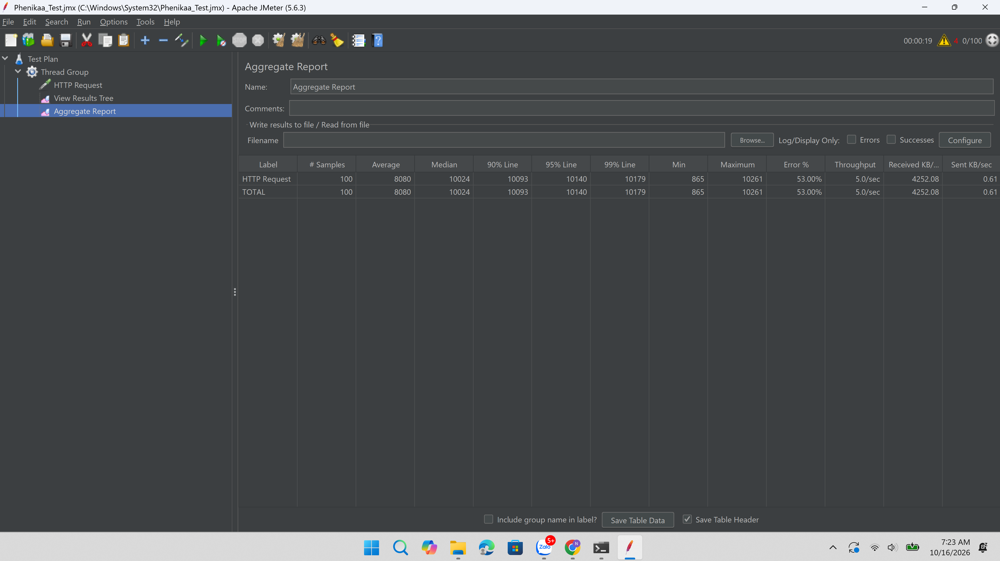

# Báo Cáo Kiểm Tra Hiệu Năng Bằng JMeter

## Kiểm tra hiệu năng trang web Phenikaa

## 1. Mục tiêu

- Học và sử dụng công cụ **Apache JMeter** để kiểm thử hiệu năng (performance test).
- Mô phỏng **100 người dùng ảo** truy cập gần như đồng thời vào trang web `https://phenikaa-uni.edu.vn/vi`.
- Đánh giá khả năng chịu tải và thời gian phản hồi của hệ thống.

## 2. Công cụ và môi trường thực hiện

| Hạng mục | Thông tin |
|---|---|
| Công cụ | Apache JMeter 5.6.3 (chạy ở chế độ GUI) |
| Hệ điều hành | Windows, máy cá nhân |
| Kết nối mạng | Wi-Fi |
| Thời điểm chạy | 16/10/2026, khoảng 07:20 (GMT+7) |
| Tổng thời gian chạy thực tế | khoảng 19 giây (theo đồng hồ của JMeter) |
| Tài liệu tham khảo |  |

**Các thành phần trong Test Plan:**

- **Thread Group**: định nghĩa số người dùng ảo, thời gian khởi tạo và số vòng lặp.
- **HTTP Request**: gửi yêu cầu GET đến trang chủ.
- **View Results Tree**: xem chi tiết từng request (trạng thái, mã phản hồi, thời gian).
- **Aggregate Report**: thống kê tổng hợp (trung bình, trung vị, percentile, tỷ lệ lỗi, throughput).

## 3. Kịch bản kiểm tra

**Thread Group**

| Tham số | Giá trị |
|---|---|
| Number of Threads (users) | 100 |
| Ramp-up period | 10 giây (khoảng 10 người dùng bắt đầu mỗi giây) |
| Loop Count | 1 (mỗi người dùng gửi 1 request) |
| Action sau khi Sampler lỗi | Continue |
| Specify Thread lifetime | Bật, Duration = 60 giây |

> **Lưu ý:** Duration được đặt 60 giây nhưng Loop Count chỉ là 1, nên mỗi thread chạy xong một vòng là kết thúc. Vì vậy tổng cộng chỉ có 100 request và bài test kéo dài khoảng 19 giây, không phải 60 giây.

**HTTP Request**

| Tham số | Giá trị |
|---|---|
| Protocol | https |
| Server Name | phenikaa-uni.edu.vn |
| Port | Mặc định (443) |
| Method | GET |
| Path | /vi |
| Content encoding | UTF-8 |
| Follow Redirects / Use KeepAlive | Bật |
| Parameters, Assertion, Timer | Không sử dụng |

## 4. Kết quả kiểm tra

| Chỉ số (Metric) | Giá trị (Value) |
|---|---|
| Tổng số yêu cầu (Total requests) | 100 |
| Yêu cầu thành công | 47 (47%) |
| Yêu cầu thất bại | 53 (53%) |
| Thời gian phản hồi trung bình (Average) | 8080 ms |
| Thời gian phản hồi trung vị (Median) | 10024 ms |
| Percentile 90% | 10093 ms |
| Percentile 95% | 10140 ms |
| Percentile 99% | 10179 ms |
| Nhỏ nhất (Min) | 865 ms |
| Lớn nhất (Max) | 10261 ms |
| Throughput | 5.0 yêu cầu/giây |

## 5. Phân tích kết quả

- **Tỷ lệ lỗi cao:** 53/100 request thất bại. Trong View Results Tree, các request lỗi trả về mã `500 Internal Server Error`.
- **Thời gian phản hồi dài:** trung bình 8080 ms, lớn nhất 10261 ms. Các mốc median, P90, P95, P99 đều tập trung quanh 10 giây.
- **Vì sao median (10024 ms) cao hơn average (8080 ms):** nhiều request lỗi cùng kết thúc quanh mốc khoảng 10 giây, trong khi một số request thành công trả về nhanh hơn (Min là 865 ms). Những giá trị nhỏ này kéo trung bình xuống thấp hơn trung vị.
- **Quan sát một request lỗi (Thread Group 1-50):** Connect Time chỉ 22 ms nhưng Latency và Load time đều khoảng 10032 ms, body phản hồi chỉ 21 byte. Điều này cho thấy kết nối được thiết lập nhanh, nhưng máy chủ mất khoảng 10 giây mới trả về lỗi 500.
- **Nguyên nhân có thể (suy đoán từ phía client):** khi 100 request dồn dập trong 10 giây, hệ thống phía sau có thể bị quá tải và một lớp trung gian (web server, proxy hoặc gateway) trả lỗi 500 sau khi hết thời gian chờ khoảng 10 giây. Ngoài ra cũng không loại trừ cơ chế giới hạn tốc độ (rate limiting) hoặc tường lửa chống tấn công. Bài test chỉ đo từ phía client nên chưa thể xác định chính xác nguyên nhân.

## 6. Kết luận

Trong kịch bản 100 người dùng truy cập dồn dập trong 10 giây, trang web `https://phenikaa-uni.edu.vn/vi` có tỷ lệ lỗi 53% và thời gian phản hồi trung bình trên 8 giây, nên **chưa đáp ứng tốt** mức tải này. Để cải thiện, có thể xem xét nâng cấp tài nguyên máy chủ, tối ưu caching (CDN, cache trang chủ) và cấu hình giới hạn kết nối phù hợp.

## 7. Hạn chế của bài test

- Mỗi người dùng chỉ gửi 1 request (Loop Count = 1), nên chưa đo được hiệu năng khi tải kéo dài.
- Chỉ kiểm tra một trang (`/vi`), chưa mô phỏng hành vi duyệt nhiều trang.
- Chưa dùng Assertion để kiểm tra nội dung phản hồi, chỉ dựa vào mã trạng thái HTTP.
- Chạy ở chế độ GUI trên máy cá nhân và qua Wi-Fi, nên kết quả có thể bị ảnh hưởng bởi băng thông và tài nguyên máy chạy test.
- Chỉ chạy một lần, chưa lặp lại để lấy kết quả trung bình.

## 8. Cách chạy lại bài test

1. Cài đặt Java và tải Apache JMeter 5.6.3.
2. Mở JMeter, chọn **File > Open** và mở file `Phenikaa_Test.jmx`.
3. Nhấn nút **Start** (mũi tên xanh) và xem kết quả ở **View Results Tree** và **Aggregate Report**.

## 9. Hình ảnh minh họa

**Cấu hình Thread Group**

**Cấu hình HTTP Request**

**View Results Tree** (request lỗi 500 Internal Server Error)

**Aggregate Report**

